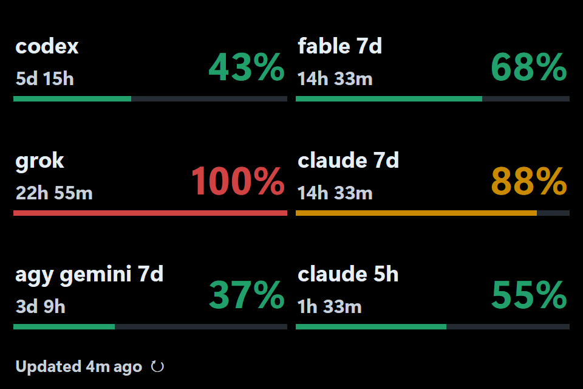
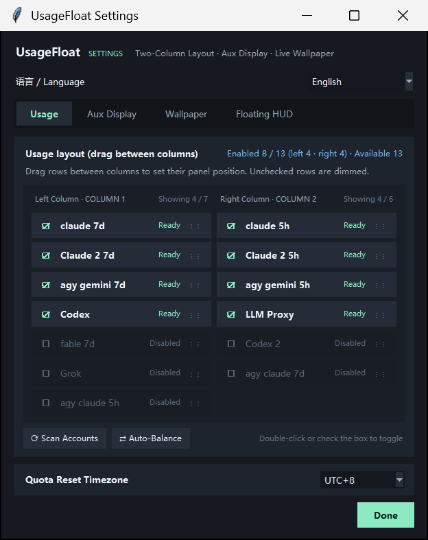
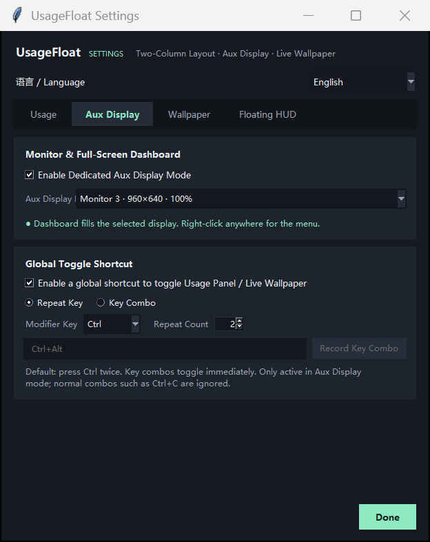
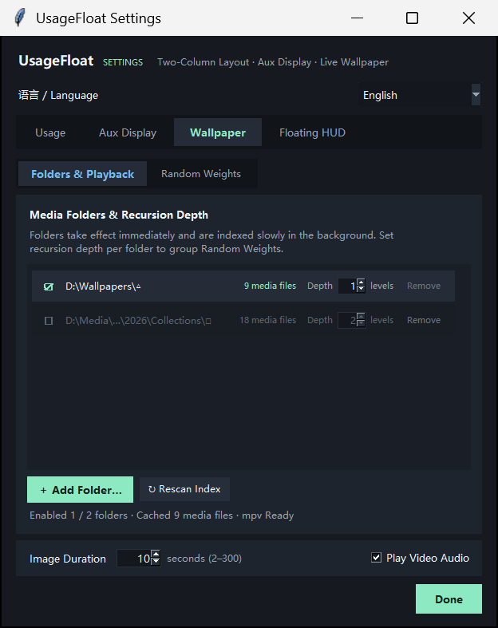
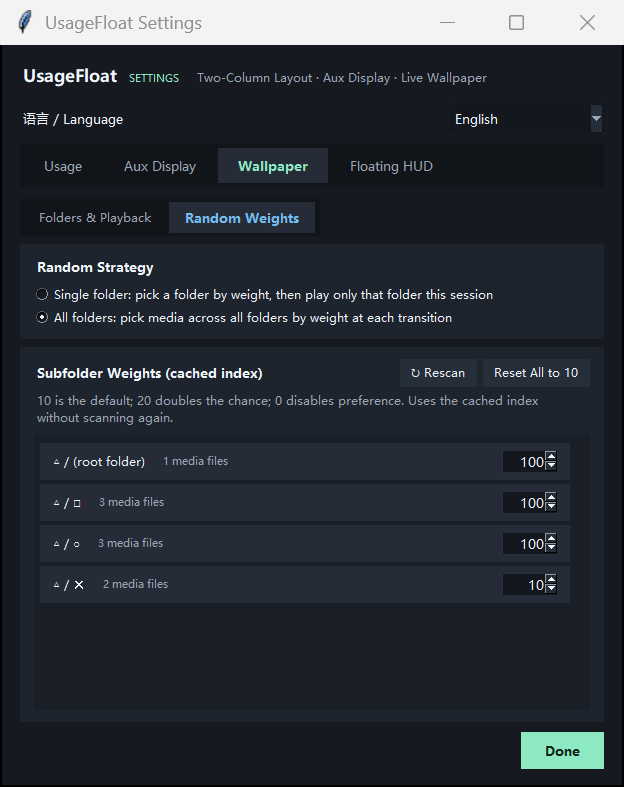

# usage-float

A headless multi-subscription quota collector for coding-agent routing workflows: a CLI (`python usage_float.py once`), a local JSON telemetry cache (`~/.usage-float/usage-cache.json`) and a [`check-quota` Agent Skill](skills/check-quota/SKILL.md) that let Claude Code, Codex, Antigravity, Paseo and routers read live 5-hour and 7-day rate-limit windows and reset timers across **Claude Code** (Claude Max / Pro), **OpenAI Codex CLI** / **ChatGPT Pro**, **Grok**, **Google Antigravity** (`agy` / Gemini CLI), **Magpie**, and **LiteLLM / OpenAI-compatible API proxies**. It also ships a borderless Windows desktop quota HUD (no title bar, no taskbar entry), an auxiliary-screen dashboard, and an optional live-wallpaper player toggled with a double-tap of `Ctrl`.

- **Multi-Account Local Quota Discovery**: Reads multiple local credentials (`~/.claude`, `~/.claude-2`, `~/.claude-*`, `~/.codex`, `~/.codex-2`, `~/.codex-*`, `~/.grok`, `agy`, Paseo provider directories, and remote Magpie `/v1/magpie/quotas`) directly on your machine without rotating OAuth tokens.
- **One-Click Rate-Limit Reset Redemption**: Inspects and redeems **Claude weekly rate-limit resets (`cedar_ember`)**, **Claude 5-hour session wall resets (`juniper_tide`)**, and **ChatGPT / Codex rate-limit reset credits (`/backend-api/wham/rate-limit-reset-credits`)** directly from the HUD.
- **Headless CLI & JSON Cache for Agents**: Run `python usage_float.py once` (or read `~/.usage-float/usage-cache.json`) from scripts, routers, or coding agents to query remaining subscription percentages and reset timestamps programmatically.

## For Coding Agents (Skill & JSON Cache Schema)

**Skill**: [`skills/check-quota/SKILL.md`](skills/check-quota/SKILL.md) teaches an agent to check subscription headroom before dispatching a sub-agent or starting long work. Copy or link the `skills/check-quota` folder into your host's skills directory (for example `~/.claude/skills/check-quota`, `~/.codex/skills/check-quota`).

**Headless CLI**: `python usage_float.py once` (release binary: `UsageFloat.exe once`) queries each signed-in provider once and prints one line per window with usage and time to reset. No UI is opened.

**JSON cache**: the same readings are persisted to `~/.usage-float/usage-cache.json` (atomic writes under a file lock), so an agent can read quota without any network call. Abbreviated example (illustrative values):

```json
{
  "providers": {
    "claude": {
      "provider_id": "claude",
      "display_name": "claude",
      "plan_label": "max",
      "windows": [
        {"id": "seven_day", "label": "7d", "used_pct": 42.0, "resets_at": "2026-11-05T21:00:00+00:00"},
        {"id": "five_hour", "label": "5h", "used_pct": 8.0, "resets_at": "2026-10-30T08:00:00+00:00"}
      ],
      "error": null,
      "available": true,
      "stale": false,
      "fetched_at": "2026-10-30T03:21:28+00:00",
      "summary": null
    },
    "codex": {"provider_id": "codex", "plan_label": "pro", "windows": [{"id": "usage", "label": "7d", "used_pct": 93.0, "resets_at": "2026-11-04T06:35:27+00:00"}], "stale": false}
  }
}
```

| Field | Meaning |
|---|---|
| `providers.<id>` | One entry per account (`claude`, `claude-2`, `codex`, `codex-2`, `grok`, `antigravity`, `llmproxy`, ...) |
| `windows[].id` / `label` | Window identifier and display label, for example `seven_day` / `7d`, `five_hour` / `5h`, `weekly_fable` / `fable 7d`, `gemini-weekly` / `gemini 7d` |
| `windows[].used_pct` | Percent of the window already used (0-100); remaining headroom is `100 - used_pct` |
| `windows[].resets_at` | ISO-8601 time the window resets |
| `plan_label` | Subscription tier when known (for example `max`, `pro`) |
| `fetched_at`, `stale`, `error` | Freshness of the reading; `stale: true` or a non-null `error` means the last refresh failed and the numbers are older |
| `summary` | Free-text figure for budget-style rows such as the LiteLLM proxy |

The cache also holds bookkeeping keys (`display_snapshots`, `attempts`, `poll`, per-provider `*_backoff_until`) that consumers can ignore.

**With AgentCompass**: [AgentCompass](https://github.com/akiiwa-games/AgentCompass) (`agent-compass`) reads `~/.usage-float/usage-cache.json` to score task difficulty against live quota windows and pick the best-fit account, model and effort. Usage Float also runs on its own with no AgentCompass installed.

## AgentCompass integration

[AgentCompass](https://github.com/akiiwa-games/AgentCompass) uses Usage Float as its subscription quota collector and optional floating HUD. Usage Float also runs independently; AgentCompass adds task routing, quota scheduling, and a Windows management panel.

## Screenshots

Dedicated auxiliary-screen usage dashboard:



Usage settings (two-column drag-and-drop layout; unchecked items are dimmed in place):



Auxiliary display and shortcut settings:



Live wallpaper folders and recursion depth (instant add, background indexing, middle-segment path truncation):



Live wallpaper folder random weights:



## Installation & Quick Start

**Release package (recommended)**: Download `usage-float-*-windows-x64.zip` from the repository's Releases page, extract it, and run `UsageFloat.exe`. No Python installation is required (`mpv` is bundled). If Windows SmartScreen prompts on an unsigned binary, choose **More info → Run anyway**. Toggle **Start at login** from the right-click context menu.

**Run from source**: Requires Windows + Python 3.10+ (with `tkinter`). For video wallpapers, run `.\install-mpv.ps1` first or place `mpv.exe` under `vendor/mpv/`.

```powershell
python usage_float.py once          # Print a one-shot CLI usage summary (release binary: UsageFloat.exe once)
pythonw usage_float.py              # Launch floating HUD / auxiliary-screen panel
.\start.vbs                         # Launch detached from the current shell session
python usage_float.py autostart on  # Enable startup at Windows logon
```

## Credentials & Dynamic Account Discovery

All credentials stay on your local machine and are read directly without third-party servers:

| Provider | Default Local Credential Source |
|---|---|
| **Claude** | `~/.claude/.credentials.json` |
| **Additional Claude Accounts** | `~/.claude-2/.credentials.json` (`CLAUDE_HOME_2`), `~/.claude-*`, or Paseo provider `CLAUDE_CONFIG_DIR` bindings |
| **Codex** | `~/.codex/auth.json` |
| **Additional Codex Accounts** | `~/.codex-2/auth.json` (`CODEX_HOME_2`), `~/.codex-*`, or Paseo provider `CODEX_HOME` bindings |
| **Grok** | `~/.grok` login state |
| **Antigravity** | Official `agy` CLI (`1.1.11+`) login state via `PATH`, `%LOCALAPPDATA%\agy\bin\agy.exe`, or `ANTIGRAVITY_CLI_PATH` |
| **LiteLLM / API Proxy** | Environment variables `LLM_PROXY_API_KEY` + `LLM_PROXY_ENDPOINT`, or `llm_proxy_api_key` / `llm_proxy_endpoint` in `~/.usage-float/config.json` |

### Signing in to a Second Codex Account

```powershell
$env:CODEX_HOME="$env:USERPROFILE\.codex-2"; codex login
```

### Grok and Grok Bot share one meter

On 2026-10-29 the user confirmed both official apps show the same subscription
usage (56%). The Grok row includes Grok Bot consumption. Only the Grok billing
observation is collected; there is no separate Bot row or native Bot cache reader.
An enabled legacy Bot display selection maps to the ordinary Grok entry, even if
the old Grok selection was disabled. Duplicate fetches collapse to one Grok read;
the retired Bot display entry disappears. No special shared-pool label is added.

### Remote Magpie Subscription Quotas

When a Claude subscription is hosted behind a remote Magpie gateway instead of local OAuth credentials, create `usage-float.json` inside the corresponding Claude config directory (for example `~/.claude-2/usage-float.json`):

```json
{"source": "magpie", "provider": "claude", "account": "you@example.com"}
```

`usage-float` reuses `ANTHROPIC_BASE_URL` (HTTPS) and `ANTHROPIC_AUTH_TOKEN` / `ANTHROPIC_API_KEY` from `settings.json` in the same directory (or Paseo provider environment variables) to query `/v1/magpie/quotas` for that account's 5-hour and 7-day subscription windows and reset timestamps. No local OAuth token is required. If a query fails, `usage-float` never falls back to a different local subscription and marks the cached reading as stale. Magpie-backed accounts display usage only and do not expose local Claude rate-limit reset buttons.

## Controls & Interactions

| Action | Effect |
|---|---|
| Click bottom-left refresh bar / `F5` | Refresh active providers now |
| Click a **Codex** usage percentage | Open the banked rate-limit reset credit dialog for that Codex account |
| Click a **`claude 7d`** / **`claude 5h`** percentage | Open the Claude weekly or 5-hour rate-limit reset dialog for that Claude account |
| Drag window | Move the floating HUD |
| Right-click | Refresh / Settings / Toggle auxiliary-screen panel / Always on top / Start at login / Exit |
| Shortcut (default: double-tap `Ctrl`) | Toggle between **Usage Dashboard** and **Live Wallpaper** |
| `Esc` | Exit |
| `Home` | Reset floating HUD position to the primary display corner |

## Settings

Right-click -> **Settings...**

Use the **Language** selector at the top of Settings to switch between Simplified Chinese (zh, default) and English (en). The selection is saved immediately in ~/.usage-float/config.json (independent of the AgentCompass tray language) and live-refreshes Settings, the floating HUD, the auxiliary-screen dashboard, context menus, and rate-limit reset dialogs without restarting.

### Usage Tab

- **Two-Column Drag-and-Drop Layout**: Drag any provider row freely between the left and right columns to arrange the auxiliary-screen dashboard; unchecked rows remain visible and dimmed in place.
- **Scan Available Accounts**: Automatically discovers local Claude/Codex homes, Paseo provider directories, Magpie gateways, Grok, and Antigravity, reporting `Ready`, `Disabled`, or `Not Detected`.
- **Quick Toggle & Auto-Balance**: Click the checkbox or double-click any row to toggle it on/off, or click **Auto-Balance Columns** to split enabled rows evenly across both columns.
- **Granular Provider Windows**:
  - Each Claude account splits into independent `fable 7d`, `claude 7d`, and `claude 5h` rows (e.g., `Claude 2 fable 7d`, `Claude 2 7d`, `Claude 2 5h`).
  - Antigravity splits into four independent rows sharing a single CLI probe: `agy gemini 7d`, `agy gemini 5h`, `agy claude 7d`, and `agy claude 5h` (abbreviated to `gem` in compact floating mode).
- **Clean Failure Handling**: Providers without local credentials take no space. When a refresh fails, an error label is shown only if no prior valid snapshot exists for that credential.
- **API Proxy Reset Timezone**: Configurable timezone for weekly LiteLLM proxy budget resets (defaults to `UTC+8`).

### Auxiliary Display Tab

- Select a target monitor and enable **Dedicated Auxiliary-Screen Mode**. `usage-float` binds to the monitor's hardware identifier, automatically restoring full-screen panel layout when the display is hot-plugged and falling back to the floating HUD while disconnected.
- Customize the wallpaper toggle shortcut (repeated key press `2–8` times, or key combination such as `Ctrl+Alt`).

### Live Wallpaper Tab

- **Folder Management & Recursion Depth**: Add media directories with configurable subdirectory recursion depth (`0–8` levels) and per-folder random selection weights.
- **Background Indexing**: Newly added folders take effect immediately while a background scanner builds and persists `~/.usage-float/wallpaper-index.json`, so opening the weight dialog never re-scans the disk. Long paths automatically truncate middle segments while preserving the root and leaf folder names.
- **Supported Media**: `JPG`, `PNG`, `WebP`, `GIF`, `MP4`, `WebM`, `MKV`, and `MOV`.
- **Playback Behavior**:
  - Starts on a weighted random item. Videos under 30 minutes play from the beginning; longer videos jump to a random chapter (or a random timestamp if unchaptered).
  - Images display for 10 seconds by default (`2–300` seconds configurable); portrait images center-crop to a square while landscape images and videos fill the panel.
  - When the panel is focused: `Left` / `Right` arrows seek `±5s` in video mode or step to the previous/next image; the mouse wheel adjusts volume.
- **Instant Drag-and-Drop & Web Video Playback**:
  - Drop a local video file onto the window to loop that file immediately.
  - Drag and drop an entire browser window, a torn-off browser tab, a web link, a video thumbnail card, a `.url`/`.html` file, or press `Ctrl+V` (or right-click → **Paste Web/Video URL to Play**) to launch an embedded borderless browser that full-screens and loops the web video (automatically closing the dragged source browser window after reading its URL), with `Left`/`Right` `±5s` seeking, mouse-wheel volume, and mute controls.
  - Switching back to the Usage Dashboard terminates `mpv` or the embedded browser process immediately so zero background decoding remains.

## Rate-Limit Reset Credits & Provider Mechanics

### Codex Rate-Limit Reset Credits

Eligible ChatGPT Plus / Pro subscriptions receive banked rate-limit reset credits valid for 30 days. Clicking a Codex row's usage percentage opens the credit list strictly scoped to that account (`CODEX_HOME`):

- **List credits**: `GET https://chatgpt.com/backend-api/wham/rate-limit-reset-credits`
- **Redeem credit**: `POST https://chatgpt.com/backend-api/wham/rate-limit-reset-credits/consume` with a unique `redeem_request_id` for idempotent deduplication.

### Claude Rate-Limit Resets

#### Weekly Reset (`cedar_ember`)

Anthropic grants eligible accounts `/limit-reset` entitlements (internal program `cedar_ember`). Clicking the `claude 7d` percentage opens a dialog showing grant expiration times and resettable windows.

Entitlement status piggybacks on the regular usage request with zero extra API calls:

```http
GET https://api.anthropic.com/api/oauth/usage?cedar_ember=1&skip_spend=1
```

Because Anthropic only returns this block to the CLI surface (plain requests receive `ineligible_reason: "surface"`), `usage-float` sends `anthropic-client-platform: cli` and dynamically reads the installed `@anthropic-ai/claude-code/package.json` version for `User-Agent: claude-cli/<version>`.

Redeeming a reset sends the exact CLI payload:

```http
POST https://api.anthropic.com/api/organizations/<organizationUuid>/reset_rate_limits
{"program": "cedar_ember", "grant_id": "<next_grant_id>", "request_id": "<uuid>"}
```

- Only `next_grant_id` can be redeemed immediately; additional grants appear as queued.
- `organizationUuid` is read from `oauthAccount.organizationUuid` in `~/.claude.json` (falling back to `/api/oauth/profile`).
- Network errors, `5xx`, or `429` responses reuse the same `request_id` on retry so a grant is never double-spent.

#### 5-Hour Session Wall Reset (`juniper_tide`)

Clicking `claude 5h` checks for the experimental weekly 5-hour session reset (`juniper_tide`), which becomes available only when an eligible account hits the 5-hour wall. Opening the dialog performs a read-only probe against `GET https://api.anthropic.com/api/oauth/usage?at_wall=1&skip_spend=1` and redeems via:

```http
POST https://api.anthropic.com/api/organizations/<organizationUuid>/reset_rate_limits
{"program": "juniper_tide"}
```

### Antigravity Usage

Queries the official `agy` CLI's structured output:

```powershell
agy -p /usage --output-format json
```

Runs inside an empty temporary directory using the CLI's own login state without reading or copying tokens, enforces a 60-second timeout and 1 MiB output cap, and cleans up child processes on exit. Requires `agy` `1.1.11+` so older CLI versions never mistake `/usage` for a model prompt.

### LiteLLM Proxy Usage

Since LiteLLM virtual keys rarely have permission to call `/key/info`, `usage-float` sends a lightweight embeddings probe (falling back to a minimal chat completion) and reads `x-litellm-key-spend` and `x-litellm-key-max-budget` from the response headers.

## Configuration & Caching Architecture

Settings are stored in `~/.usage-float/config.json`:

Set `"language": "en"` for English or `"language": "zh"` for Simplified Chinese. Chinese remains the default for existing configurations that omit the field. Values are case-insensitive; `zh-cn` and `en-us` normalize to `zh` and `en`. Unsupported values fall back to `zh`.

```json
{
  "language": "zh",
  "always_on_top": true,
  "providers": ["codex", "codex-2", "grok", "claude:fable", "claude:7d", "claude:5h", "antigravity:gemini-weekly", "antigravity:gemini-5h", "antigravity:3p-weekly", "antigravity:3p-5h"],
  "provider_order": ["codex", "codex-2", "grok", "claude:fable", "claude:7d", "claude:5h", "antigravity:gemini-weekly", "antigravity:gemini-5h", "antigravity:3p-weekly", "antigravity:3p-5h"],
  "disabled_providers": [],
  "refresh_seconds": 300,
  "display_mode": "panel",
  "shortcut_enabled": true,
  "shortcut_mode": "repeat",
  "shortcut_key": "ctrl",
  "shortcut_repeat_count": 2,
  "shortcut_combo": ["ctrl", "alt"],
  "wallpaper_folders": ["D:\\Wallpapers"],
  "wallpaper_image_seconds": 10,
  "wallpaper_audio": true,
  "llm_proxy_api_key": "",
  "llm_proxy_endpoint": "",
  "llm_proxy_budget_duration": "7d",
  "llm_proxy_timezone": "UTC+8"
}
```

- **Minimum Refresh Interval**: `refresh_seconds` has a 300-second floor.
- **Activity-Aware Cadence & 429 Backoff**: Active accounts poll roughly every 5 minutes, idle accounts every 30 minutes, and accounts with unknown activity every 15 minutes. Failed probes respect the same cadence and per-credential `429` backoff; reopening the window never forces an upstream call.
- **Read-Only Credential Safety & Fingerprint Binding**: Snapshots in `~/.usage-float/usage-cache.json` are bound to a one-way SHA-256 fingerprint of their local credential and directory and written under a cross-process file lock (`usage_lock.py`) via atomic replacement. `usage-float` never rotates or writes CLI OAuth tokens; if a request fails with `401`, it re-reads the disk credential at most once in case the CLI refreshed it, and never replays a rate-limit reset `POST`.

## Development

```powershell
python -m unittest discover -p "test_*.py"
.\build-release.ps1    # Builds dist\usage-float-<version>-windows-x64.zip
```

## License

MIT License. `mpv` is distributed under the GPL: the source repository does not include the binary (`install-mpv.ps1` downloads it on demand); release archives bundle `mpv` alongside [THIRD_PARTY_NOTICES.md](THIRD_PARTY_NOTICES.md).

## Related Projects

- [AgentCompass](https://github.com/akiiwa-games/AgentCompass) — task routing and quota scheduling across your AI subscriptions.
- [lark-mbti-jev](https://github.com/akiiwa-games/lark-mbti-jev) — a local Feishu/Lark MBTI and anime persona overlay powered by Jev.
